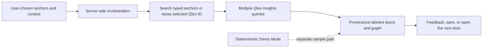

# Open Door

**Public repository:** [jdinovitser/Open-Door](https://github.com/jdinovitser/Open-Door)

**Submission review:** [official criteria and evidence](docs/JUDGING_CRITERIA.md) · [remaining submission gates](docs/SUBMISSION_READINESS.md) · [Devpost draft](docs/DEVPOST_DRAFT.md) · [why this product](docs/WHY_OPEN_DOOR.md).

Before submission, verify live Qloo discovery on the published site and the completed Devpost entry. A prepared Demo is not evidence of a live Qloo integration.

**Find your way into a new place.**

Open Door is a cultural discovery web app that turns personal interests into a starting point for exploring unfamiliar experiences. Its live discovery path uses Qloo Search and Insights to connect interests across cultural domains when configured. It is designed around a simple progression: what someone already loves, a visible cultural thread, and a few possible doors to open next.

## Project status

This workspace has a responsive Demo Mode and a server-side Qloo integration. **Live Qloo Search and Insights have been verified in development; the published site must be republished and checked separately.** The authored sample journeys are not Qloo results, real venue or event listings, or statements about local availability.

## Problem

When people arrive somewhere unfamiliar, a conventional search can return the thing they already know to ask for. The harder question is where their interests could lead next.

## Solution

Open Door lets people provide a place, explicit cultural anchors, intent, discovery depth, and current constraints. When a Qloo hackathon key is configured, the server resolves those anchors with Qloo Search and makes multiple Qloo Insights requests. It presents up to three Qloo-backed directions:

- **Familiar** — a close cultural echo
- **Adjacent** — a neighboring practice
- **Unexpected** — a cross-category direction with its connection explained

Demo Mode also includes exploration-depth choices, editable anchor categories, context controls, a three-person group example, saved doors, explicit feedback, a shareable story with selected details, and activity counts based on user actions.

## Why Qloo

Qloo provides the entity search and Insights results that can connect a user's chosen interests to other cultural domains. The server requests Qloo explainability and retains the returned entity IDs and source metadata for the journey inspector.

Live Qloo use is not active until a key is provisioned and an actual request succeeds. Demo explanations and connections are deterministic sample content and must not be represented as Qloo-derived evidence.

## What makes it agentic

The live path is an explicit structured tool orchestration: interpret the user's stated intent, resolve typed anchors with Qloo Search (or reuse the exact Qloo entity ID when a previously returned door is opened), query multiple entity types through Qloo Insights, evaluate returned candidates, balance the three route labels, and build an evidence graph. No external LLM is used. If a Qloo request fails or returns no candidate, the live journey fails visibly or remains partial; it never silently substitutes sample results.

## Architecture



## Qloo integration

### Choose a connection

- **Demo** uses the project's shared server-side Qloo API key to retrieve real recommendations. Requests count toward the project's Qloo quota.
- **Connect your own** verifies a visitor's key against Qloo's hackathon API and uses that key for subsequent discovery, including Live Discovery Lab branches. Keys compatible with the hackathon API are required; this is API-key authentication, not account OAuth.
- **Try prepared examples** remains a separate, network-independent sample path, also available at `/demo`. Historical references to “Demo Mode” in the technical documentation refer to these authored examples, not the shared Demo connection.

Personal keys are held only in server-process memory for up to one hour. An HttpOnly, SameSite=Strict cookie contains a random session identifier, not a key; HTTPS connections also set Secure. Keys are not written to browser storage, account storage, logs, or API responses. Disconnect, expiry, or a server restart removes the connection. Selecting a personal connection never silently falls back to the shared key. Invalid, unavailable, or rate-limited upstream connections fail visibly.

The connection source selector defaults to shared Qloo discovery; the prepared `/demo` route still explicitly selects authored examples. Qloo-backed results retain their Live Qloo provenance labels regardless of which connection supplied them.

The server calls only Qloo's documented hackathon endpoints: `GET /search` and `GET /v2/insights/` at `https://hackathon.api.qloo.com`, following the [hackathon developer guide](https://docs.qloo.com/reference/qloo-llm-hackathon-developer-guide). Qloo's key is read from the server-side `QLOO_API_KEY` secret and is never sent to the browser. Demo Mode remains an explicit, separate option.

The full endpoint, provenance, fallback, and verification notes are in [`docs/HACKATHON_INTEGRATIONS.md`](docs/HACKATHON_INTEGRATIONS.md). Request a hackathon API key through Qloo's [official access form](https://forms.gle/zz12orkLHTAneLGz6); add the provisioned key through Replit Secrets as `QLOO_API_KEY`.

## Demo

1. Open `/demo` for the prepared one-click judge journey, or start at `/` and choose the discovery mode.
2. In Demo Mode, choose an exploration depth, explicit context, and cultural anchors. In Live Mode, the server reports real orchestration stages as Qloo requests run.
3. Review the returned doors, source labels, and visible data limitations; opening one reveals its explanation.
4. Continue through a door to open a new Qloo path in Live Mode or another authored sample path in Demo Mode, or save a door for later.
5. Try Build My Day, group mode, the one-hour sample, and unopened-door choices.
6. Review and share/copy the text story, or download its SVG share card. Interests you enter may still be personal, even though city and budget are omitted.

Guest saves, the current journey, feedback, and browser opened-door history stay in local storage. Optional **Sign in** uses Replit-managed Clerk and syncs the doors a user chooses to save with PostgreSQL-backed account storage. Guest-saved doors are added to the account on sign-in; a browser-local Guest collection is retained. Full journey and Discovery Lab history are not synced.

## Account progress and rewards

Signed-in users can open `/progress` or **Progress** in the header. The supplied mascot reward concept art appears alongside three transparent tracks:

- **Brave:** distinct Unexpected doors opened; bronze at 1, silver at 3, gold at 5.
- **Explorer:** distinct categories among opened doors; bronze at 1, silver at 3, gold at 5.
- **Door Collector:** account-saved doors; bronze at 1, silver at 5, gold at 10.
- **Stars:** one through five stars at 1, 3, 6, 10, and 15 distinct opened doors.
- **Field Guide trophies:** bronze, silver, and gold at 3, 6, and 9 medal points. Each track contributes 1/2/3 points for its bronze/silver/gold medal.

Door opens are counted once per account and door ID. The main three-door journeys and saved-door exploration count; historical Guest actions and Discovery Lab branches are not imported as account progress. Demo and Live interactions both count toward these playful personal rewards; they are not Qloo scores or verified real-world achievements. Native sharing, X, LinkedIn, and copy controls share only reward summaries or the home-page URL, not saved interests or location.

Account routes derive the owner from the Clerk session, not client-supplied IDs. Account saves are capped at 100 doors and use delta updates, retryable per-user pending changes, and transaction-level limit enforcement. PostgreSQL schema is recorded in `server/schema.sql`. Development schema changes are promoted by Replit’s Publish flow; do not run schema DDL at server startup.

## Discovery Lab

Use **Branch in Discovery Lab** on an original door, **Explore in Discovery Lab** on the three-door journey, or open `/lab`. Save a checkpoint, open one of six directions, and compare independent sibling branches. Continue from a result, fork it into a new checkpoint, or restore an earlier starting point without changing its siblings.

Lab state is browser-local, separate from the original saved-door collection. It survives reloads; it is not synced across devices. Export before clearing browser data. Demo exercises are explicitly authored examples, not Qloo results, venue listings, social matches or verified itineraries. See [Discovery Lab workflow and provider boundary](docs/DISCOVERY_LAB.md).

## Running locally

```sh
npm install
npm run dev
```

The Express server and Vite middleware use port `5000`. Create a production build with:

```sh
npm run build
```

Run the production server after building with `npm start`.

Run `npm test` for server and Lab engine/provider tests. With the development app running, run `npm run test:browser` for the Discovery Lab browser journeys. Browser tests use the existing Chromium executable on Replit; elsewhere install Playwright Chromium first. `TEST_BASE_URL` can select a test origin. Generated reports and traces are kept out of source control and deployment in `generated-artifacts/`.

## Environment variables

- `QLOO_API_KEY` — optional server-side secret, required to enable Live Qloo.

Do not place API keys in frontend code or commit them to the repository. Demo Mode does not require a key.

Replit-managed Clerk provisions `CLERK_PUBLISHABLE_KEY`, `CLERK_SECRET_KEY`, and `VITE_CLERK_PUBLISHABLE_KEY`; the platform supplies `VITE_CLERK_PROXY_URL` when needed. PostgreSQL uses the server-only `DATABASE_URL`. Never expose the secret key or database URL to browser code. `SESSION_SECRET` is not used by this Clerk integration. See [`.env.example`](.env.example) for placeholder-only setup notes.

## Security, privacy, and operations

Open Door remains usable without an account. Account-saved doors and reward events are private to the Clerk-authenticated user and stored in PostgreSQL; other history remains browser-local. It has no enterprise roles, durable audit trail, enterprise admin console, or completed independent security review. Do not enter confidential or regulated information. The Trust view describes storage boundaries and deletion/export controls.

- [Security controls and limitations](docs/SECURITY.md)
- [Compliance control inventory](docs/COMPLIANCE_CONTROLS.md)
- [Third-party service data flows](docs/THIRD_PARTY_SERVICES.md)
- [Incident response guide](docs/INCIDENT_RESPONSE.md)
- [AI and recommendation evaluation](docs/AI_EVALUATION.md)
- [Accessibility notes](docs/ACCESSIBILITY.md)
- [Threat model](threat_model.md)

## Safety and responsible discovery

- The user chooses the interests and context they provide.
- The app does not infer sensitive characteristics or assign cultural identities.
- Demo connections are labeled as authored examples, not live recommendations.
- A Live label appears only for a journey produced by successful Qloo API calls.
- Discovery Distance is an Open Door ordinal route label, not a Qloo or psychological score.
- The app does not claim venue details, real-time availability, travel time, or price.
- Shared stories include only the selected anchors and discoveries; city, budget, and private profile data are excluded.

## Future opportunities

Potential extensions include verified local venue data and more live group journeys. These require separate data sources and are not implied by Qloo results. Company-branded embeds, a public partner API, and an MCP server that external company assistants could call are roadmap ideas—not currently available integrations.

## Company walkthrough

Start at **`/companies`** for the featured hotel-guest example: a free afternoon before an evening show. The editable hotel Discovery page is **`/companies/discover?type=hospitality`** and its dedicated Lab is **`/companies/lab?type=hospitality`**. Destination celebrations provide a second example through the same portal. The Judge’s Guide at **`/judges#company-walkthrough`** explains how to try the company flow.

Companies supply the occasion; individuals choose their interests and practical constraints. These are working, themed entry points into the existing discovery and branching tools, not customer endorsements, managed company workspaces, or booking services. Shared Demo and personal Qloo API access use the existing connection flow; prepared examples remain explicitly separate from live retrieval. Saved doors belong to the individual account, while company Lab histories stay in the browser.

Open Door has two entry avenues—**Explore for yourself** and **Help others explore**—with the same product identity, navigation, account and saved-door collection. Organizers can customize a public place and occasion and copy a guest link. Those links contain only public starting context, never a visitor’s tastes, health details or private preferences. Visitors can edit their own context, move between Discovery and Lab, sign in, and leave the occasion through **Explore on my own**. Company-context draft inputs are scoped to the invitation in this tab; completed Lab histories remain browser-local.

## Technology stack

- React
- TypeScript
- Vite
- Node.js and Express
- Qloo REST API (when configured)
- CSS
- Lucide React

## Judge’s Guide

The shareable five-minute walkthrough is available at **`/judges`** and linked from the footer navigation only. It explains live Qloo retrieval, entity-based continuation, branching and comparison, and evidence boundaries. It reports the server’s current Qloo configuration rather than claiming a successful live connection. Publish the latest build before sending judges the URL.

## Mascot animations

The supplied mascot poses appear across the welcome screen, Discovery Lab, saved-door empty state, and How it works—including the cultural-interest gallery and Qloo architecture illustration. Animated WebP versions keep the original GIFs lightweight. Each animation can be paused, switches to a still when offscreen, and respects the browser’s reduced-motion preference.

## Sound effects

Use **Sound off / Sound on** in the header to enable gentle door, button and exploration cues. Sound is off by default, starts only after interaction, and the preference is saved in this browser. On small screens the speaker icon is the same control. Effects are synthesized locally with Web Audio: no audio downloads, recording, or microphone permission. Muting immediately stops audio; clearing all browser data resets the sound preference. Every interaction remains usable without sound.

## License

This project is licensed under the MIT License. See [`LICENSE`](LICENSE).
