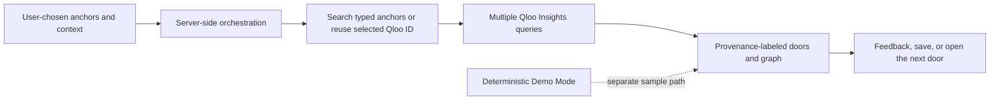

# Open Door

**Submission review:** [official criteria and evidence](docs/JUDGING_CRITERIA.md) · [remaining submission gates](docs/SUBMISSION_READINESS.md) · [Devpost draft](docs/DEVPOST_DRAFT.md) · [why this product](docs/WHY_OPEN_DOOR.md).

The app is not yet submission-ready: real Qloo responses, a public deployment, a public code repository, and the completed Devpost entry still need verification. A prepared Demo is not evidence of a live Qloo integration.

**Find your way into a new place.**

Open Door explores how cultural interests can become a starting point for discovering unfamiliar experiences. It is designed around a simple progression: what someone already loves, a visible cultural thread, and a few possible doors to open next.

## Project status

This workspace has a responsive Demo Mode and a server-side Qloo integration path. **The Qloo API key is not configured here, so no live Qloo request has yet been verified.** The authored sample journeys are not Qloo results, real venue or event listings, or statements about local availability.

## Problem

When people arrive somewhere unfamiliar, a conventional search can return the thing they already know to ask for. The harder question is where their interests could lead next.

## Solution

Open Door lets people provide a place, explicit cultural anchors, intent, discovery depth, and current constraints. When a Qloo hackathon key is configured, the server resolves those anchors with Qloo Search and makes multiple Qloo Insights requests. It presents up to three Qloo-backed directions:

- **Familiar** — a close cultural echo
- **Adjacent** — a neighboring practice
- **Unexpected** — a cross-category direction with its connection explained

Demo Mode also includes exploration-depth choices, editable anchor categories, context controls, a three-person group example, saved doors, explicit feedback, a shareable story with selected details, and activity counts based on user actions.

## Why Qloo

Qloo provides the entity search and Insights results that can connect a user's chosen interests to other cultural domains. The server requests Qloo explainability and retains the returned entity IDs and source metadata for the journey inspector.

Live Qloo use is not active until a key is provisioned and an actual request succeeds. Demo explanations and connections are deterministic sample content and must not be represented as Qloo-derived evidence.

## What makes it agentic

The live path is an explicit structured tool orchestration: interpret the user's stated intent, resolve typed anchors with Qloo Search (or reuse the exact Qloo entity ID when a previously returned door is opened), query multiple entity types through Qloo Insights, evaluate returned candidates, balance the three route labels, and build an evidence graph. No external LLM is used. If a Qloo request fails or returns no candidate, the live journey fails visibly or remains partial; it never silently substitutes sample results.

## Architecture



## Qloo integration

The server calls only Qloo's documented hackathon endpoints: `GET /search` and `GET /v2/insights/`. Qloo's key is read from the server-side `QLOO_API_KEY` secret and is never sent to the browser. The current workspace has no Qloo key, so it remains in Demo Mode.

The full endpoint, provenance, fallback, and verification notes are in [`docs/HACKATHON_INTEGRATIONS.md`](docs/HACKATHON_INTEGRATIONS.md). Request a hackathon API key through Qloo's [official access form](https://forms.gle/zz12orkLHTAneLGz6); add the provisioned key through Replit Secrets as `QLOO_API_KEY`.

## Demo

1. Open `/demo` for the prepared one-click judge journey, or start at `/` and choose the discovery mode.
2. In Demo Mode, choose an exploration depth, explicit context, and cultural anchors. In Live Mode, the server reports real orchestration stages as Qloo requests run.
3. Review the returned doors, source labels, and visible data limitations; opening one reveals its explanation.
4. Continue through a door to open a new Qloo path in Live Mode or another authored sample path in Demo Mode, or save a door for later.
5. Try Build My Day, group mode, the one-hour sample, and unopened-door choices.
6. Review and share/copy the text story, or download its SVG share card. Interests you enter may still be personal, even though city and budget are omitted.

The current journey, saved doors, feedback, and opened-door activity are kept in this browser's local storage. Live discovery sends the fields needed for a Qloo request to the Open Door server; see the Trust page for browser controls and the exact external-service data flow.

## Running locally

```sh
npm install
npm run dev
```

The Express server and Vite middleware use port `5000`. Create a production build with:

```sh
npm run build
```

Run the production server after building with `npm start`.

## Environment variables

- `QLOO_API_KEY` — optional server-side secret, required to enable Live Qloo.

Do not place API keys in frontend code or commit them to the repository. Demo Mode does not require a key.

See [`.env.example`](.env.example) for the placeholder-only setup file. The app does not currently use authentication or a server-side session, despite any workspace-level session secret being present.

## Security, privacy, and operations

Open Door is an unauthenticated single-user prototype. It has no account isolation, server-side user database, durable audit trail, or enterprise admin console. Do not enter confidential or regulated information. The Trust view describes current status, third-party services, and browser-local export/deletion controls.

- [Security controls and limitations](docs/SECURITY.md)
- [Compliance control inventory](docs/COMPLIANCE_CONTROLS.md)
- [Third-party service data flows](docs/THIRD_PARTY_SERVICES.md)
- [Incident response guide](docs/INCIDENT_RESPONSE.md)
- [AI and recommendation evaluation](docs/AI_EVALUATION.md)
- [Accessibility notes](docs/ACCESSIBILITY.md)
- [Threat model](threat_model.md)

## Safety and responsible discovery

- The user chooses the interests and context they provide.
- The app does not infer sensitive characteristics or assign cultural identities.
- Demo connections are labeled as authored examples, not live recommendations.
- A Live label appears only for a journey produced by successful Qloo API calls.
- Discovery Distance is an Open Door ordinal route label, not a Qloo or psychological score.
- The app does not claim venue details, real-time availability, travel time, or price.
- Shared stories include only the selected anchors and discoveries; city, budget, and private profile data are excluded.

## Future opportunities

Potential extensions include verified local venue data, a public judge deployment, and more live group journeys. These require separate data sources or deployment and are not implied by Qloo results.

## Technology stack

- React
- TypeScript
- Vite
- Node.js and Express
- Qloo REST API (when configured)
- CSS
- Lucide React

## License

This project is licensed under the MIT License. See [`LICENSE`](LICENSE).
